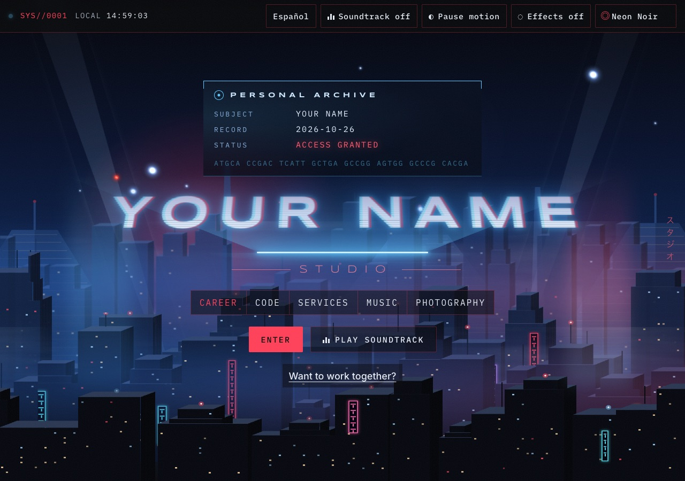
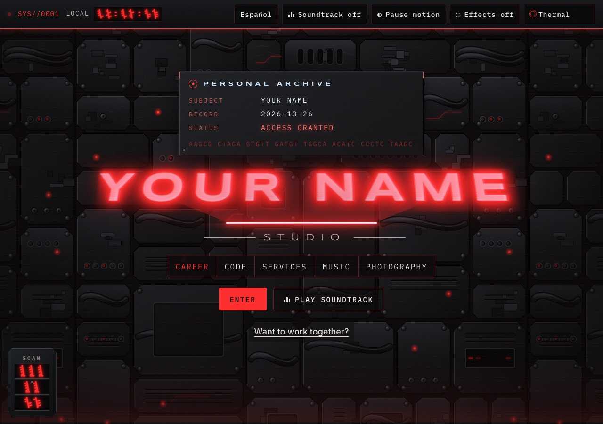
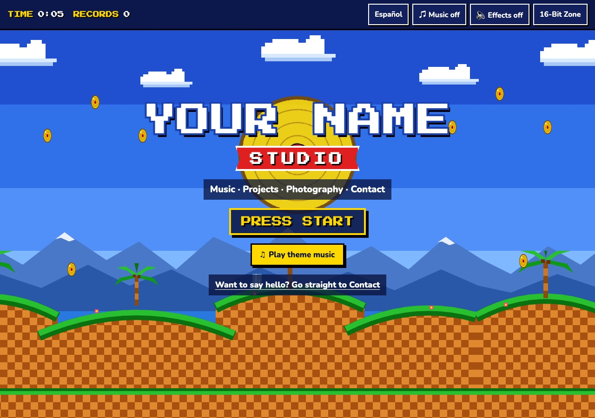

# Retro Site Themes

Three free, ready-to-edit one-page websites for a portfolio or personal site: **Neon Noir**, **Alien** and **16-Bit Zone**. *[Leer en español ↓](#en-español)*

| Neon Noir | Alien | 16-Bit Zone |
|---|---|---|
|  |  |  |
| A rainy night city with searchlights, flying cars and neon, fading to a dusty amber view further down. | A black-and-red machine HUD for Neon Noir: a wall of dark gunmetal machinery, riveted metal panels, glowing red segment glyphs in display windows, a wrist device and a three-dot targeting laser. | A 16-bit console-game title screen with pixel lettering, scrolling scenery, a score display and gold records to collect. |

**Live demo:** the [gallery page](https://bri-an-pmp.github.io/retro-site-themes/) links to all three.

## What every template includes

- **English and Spanish.** A language button switches every word on the page. Spanish uses formal *usted*.
- **A theme menu** at the top right. Neon Noir and Alien switch in place; 16-Bit Zone opens its own page.
- **Original soundtracks**, made live in the browser (no audio files): a slow neo-noir score for Neon Noir, an action-thriller score for Alien (suspense, then a military drum march with brass), and chiptune music for 16-Bit Zone, plus optional sound effects. Both are off until the visitor turns them on.
- **Sections ready to fill in:** career/résumé, projects loaded live from GitHub, services, music links, photo collections and social links.
- **Accessibility:** keyboard navigation, screen-reader labels, readable contrast, 44px tap targets, phone layouts, and a "Pause motion" button that respects the visitor's reduced-motion setting. In Alien, decorative glyphs sit beside the real numbers, so screen readers still hear them.
- **Privacy:** no cookies, analytics or trackers. The fonts are stored in the template, not loaded from Google. Music players load only when the visitor presses **Load player**.
- **No build step:** plain HTML, CSS and JavaScript. Any web host works.

## Use it for your own site

### 1. Get the files

Download this repository (**Code → Download ZIP**) and unzip it. Keep the template folder you want: `neon-noir/` (which includes Alien), `16-bit-zone/`, or both. When both are kept side by side, their theme menus link to each other.

### 2. Make it yours

Open the files in any text editor. Look for comments that start with `EDIT:`.

| To change | Edit |
|---|---|
| Your name | `index.html`: the places marked `EDIT: your name` |
| All other text, in English and Spanish | `js/i18n.js`: every phrase has an `en` and an `es` version |
| Your GitHub projects | `js/main.js`: set `GITHUB_USER` at the top |
| Music links or embedded players | `index.html` (Sound section) and `EMBEDS` in `js/main.js`. For an embedded player, also add its website to `frame-src` in the Content-Security-Policy line near the top of `index.html` |
| Photos (Neon Noir) | Put them in `assets/photos/<collection>/` as `01.jpg`, `01-thumb.jpg`… and list them in `js/albums.js` |
| Your portrait (Neon Noir) | Replace `assets/portrait.svg`, or point the `` in the Career section to your photo |
| Colors | The color settings at the top of `styles.css` (`:root { --amber: …; --cyan: … }`) |
| The theme menu | Remove an `<option>` from `#theme-select` in `index.html` to hide a theme |

To preview on your computer, open Terminal in the template folder, run `python3 -m http.server 8000`, then open http://localhost:8000. Opening `index.html` directly from Finder or Explorer won't work, because browsers block JavaScript modules on `file://`.

### 3. Publish it free with GitHub Pages

1. Create a free account at github.com and click **New repository**. Name it `yourname.github.io` for a site at that address, or any name for `yourname.github.io/name`.
2. Click **uploading an existing file** and drag in the contents of your template folder: `index.html`, `styles.css`, `fonts.css` and the `js` and `assets` folders.
3. Open **Settings → Pages**. Under **Branch**, choose `main` and click **Save**. After a minute or two your site is live at the address shown there.
4. Optional: to use your own domain, add it under **Settings → Pages → Custom domain** and follow GitHub's DNS instructions.

## Inside the templates

- **Neon Noir:** the skyline layers are SVGs drawn by `tools/city.py`, so you can regenerate them with different settings. Rain and flying cars are drawn on a canvas. The parallax responds to the mouse and to scrolling.
- **Alien:** the machine background is `assets/machine.svg`, a tileable panel drawn by `tools/machine.py` (run it with a different number, e.g. `python3 tools/machine.py 12`, for a new layout). Photos, app screenshots and the portrait keep their real colors. The glyphs are drawn in `js/theme.js`: each digit is a slanted spine with four glowing bars, a long bar on the right for a 1 bit and a short bar on the left for a 0 bit. The targeting dots only appear with a mouse, and never when reduced motion is on.
- **16-Bit Zone:** the scenery is SVG and CSS, the soundtrack and effects use the Web Audio API, and the score display counts the gold records a visitor collects.

## Licenses

- **Code, artwork and music:** [MIT](LICENSE). Use them for personal or commercial sites, and change anything you like.
- **Fonts:** Inter, IBM Plex Mono, Nunito and Press Start 2P are under the SIL Open Font License, and Syncopate is under Apache 2.0. Their license files are in [`licenses/`](licenses/) and must stay with the fonts.
- **Original work:** all artwork, music and glyphs were made for this project. The templates aren't affiliated with or endorsed by any film, game or studio, and they contain no characters, logos, names or assets from one.

Made by [Brian Athey](https://brianathey.studio) with Claude Code. Corrections and improvements are welcome: open an issue or a pull request.

---

## En español

Tres sitios web de una página, gratuitos y listos para editar, para un portafolio o un sitio personal: **Neón Noir**, **Alienígena** y **Zona 16 bits**.

**Demostración en vivo:** la [página de presentación](https://bri-an-pmp.github.io/retro-site-themes/) enlaza las tres.

### Qué incluye cada plantilla

- **Inglés y español:** un botón cambia todo el texto de la página. El español usa *usted*.
- **Menú de temas** arriba a la derecha: Neón Noir y Alienígena (una máquina en negro y rojo) cambian en la misma página; Zona 16 bits abre su propia página.
- **Banda sonora original**, creada en vivo en el navegador (sin archivos de audio), y efectos de sonido opcionales. Ambos están apagados hasta que el visitante los activa.
- **Secciones listas para completar:** carrera o CV, proyectos tomados en vivo de GitHub, servicios, enlaces de música, colecciones de fotos y redes sociales.
- **Accesibilidad:** navegación con teclado, etiquetas para lectores de pantalla, buen contraste, botones de 44 px, diseño para teléfonos y un botón para pausar el movimiento.
- **Privacidad:** sin cookies, analítica ni rastreo. Las fuentes están dentro de la plantilla y no se cargan desde Google.
- **Sin compilación:** HTML, CSS y JavaScript sencillos. Funciona en cualquier servidor web.

### Cómo usarla en su propio sitio

1. **Descargue los archivos:** **Code → Download ZIP**. Conserve la carpeta de la plantilla que quiera: `neon-noir/` (que incluye Alienígena), `16-bit-zone/` o ambas.
2. **Personalícela:** busque los comentarios `EDIT:`. Su nombre está en `index.html`; todo el texto en inglés y español está en `js/i18n.js`; su usuario de GitHub va al principio de `js/main.js` (`GITHUB_USER`); las fotos van en `assets/photos/` y se enumeran en `js/albums.js`; los colores están al principio de `styles.css`.
3. **Vista previa:** abra Terminal en la carpeta de la plantilla, ejecute `python3 -m http.server 8000` y abra http://localhost:8000. Abrir `index.html` con doble clic no funciona, porque los navegadores bloquean los módulos de JavaScript en `file://`.
4. **Publíquela gratis con GitHub Pages:** cree un repositorio en github.com, suba el contenido de la carpeta de la plantilla (**uploading an existing file**), abra **Settings → Pages**, elija la rama `main` y pulse **Save**. En uno o dos minutos su sitio estará en línea.

### Licencias

- **Código, arte y música:** licencia [MIT](LICENSE): puede usarlos en sitios personales o comerciales y modificarlos.
- **Fuentes:** Inter, IBM Plex Mono, Nunito y Press Start 2P tienen la licencia SIL Open Font License, y Syncopate, Apache 2.0. Sus licencias están en [`licenses/`](licenses/) y deben acompañar a las fuentes.
- **Obra original:** todo el arte, la música y los glifos se crearon para este proyecto. Las plantillas no tienen relación con ninguna película, videojuego o estudio, ni cuentan con su aval, y no contienen personajes, logotipos, nombres ni recursos de ninguno.
